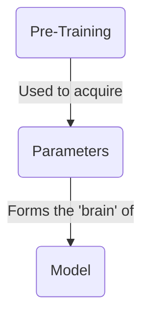
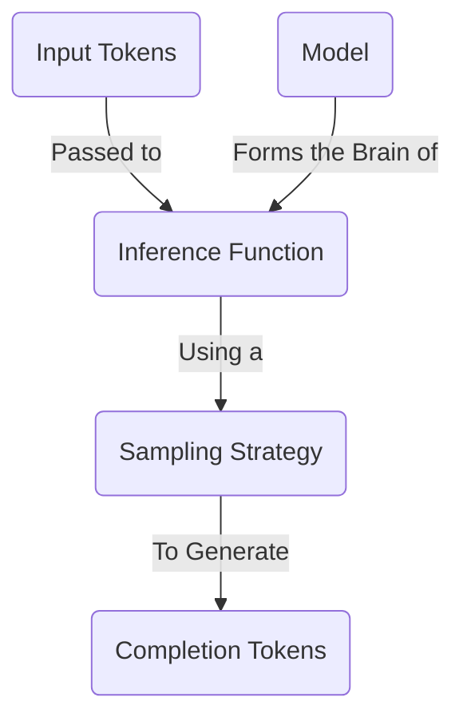
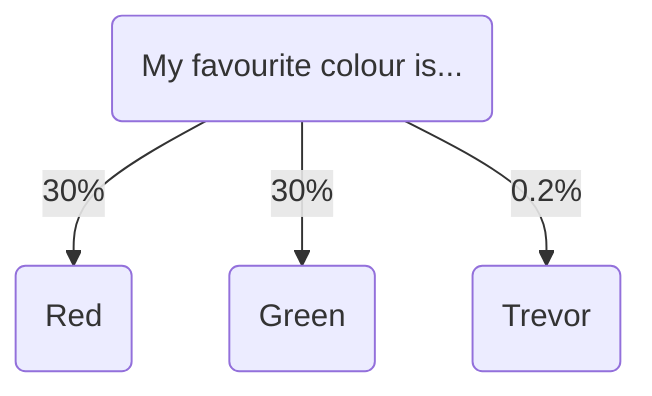
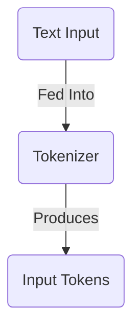
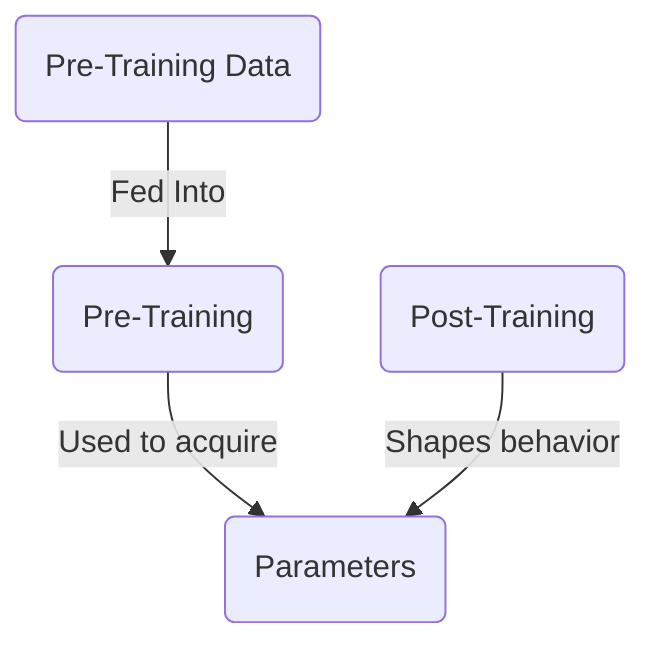
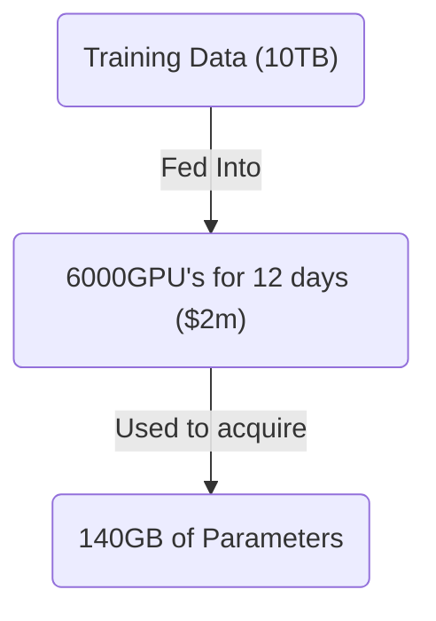
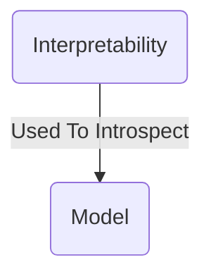

本文将介绍大语言模型的基础知识。我们会讨论它们是什么、如何工作，并简单了解创建它们的过程。

外面的许多资源都会非常深入地讲解 LLM 的工作原理——我们不会这样做。相反，我会简要介绍最常见的概念，让你可以继续动手构建。

## 什么是大语言模型？



大语言**模型**本质上是一个巨大的压缩文件——可以把它想象成一个 1TB 的 zip 文件。这个文件包含一大堆数字，以 16 位浮点数编码。这些数字就是模型的**参数**。

```txt
0.1239784871238176123 // Parameter 1
0.1515689756890123123 // Parameter 2
```

这些参数代表模型的“脑”。它们是模型**预训练**的结果：这个过程会获取海量文本数据，并将其“压缩”成这些数字。它们代表模型对世界的理解，并赋予模型记忆事实和做出决策的能力。

这些参数的数量代表模型大脑的大小。一般来说，大脑更大的模型表现更好，但运行速度更慢。一个拥有 **70B 参数的模型，其运行速度约比拥有 7B 参数的模型慢 10 倍**。

我们已经看到了大小与速度之间的权衡——这是选择大语言模型时的常见主题。

## 如何运行大语言模型？



为了让模型完成任何有用的事情，你需要对模型执行**推理**。

推理是向模型发送文本并获得响应的过程。这个过程使用**推理函数**完成——这是一段软件，它接收模型的参数，并在其上运行算法来找出下一个词。这比预训练模型便宜得多，而且可以在你的笔记本电脑上完成。

如果想深入了解推理的工作方式，可以看看[这个精彩的交互式演示](https://bbycroft.net/llm)。

### 采样策略

为了找出下一个词，模型会查看它可以选择的所有可能 Token，然后选出一个。



为此，它会使用开发者选择的**采样策略**。这个策略决定模型如何选择下一个词。最常见的策略包括：

- **贪心采样**：模型总是选择最可能的词。
- **Top-K 采样**：模型从最可能的前 K 个词中选择。
- **Top-P 采样**：模型从构成概率质量 P% 的词中选择。
- **温度采样**：模型在选择过程中引入随机性，从而产生更多样的输出。

本文不打算详细介绍这些策略。通常，作为 AI 工程师，你无法改变正在使用的模型的采样策略。不过，你可以调整温度等变量，以获得不同的结果。

## 什么是输入 Token？



当你向模型发送文本时，它首先需要进行**分词**。这个过程会将文本拆分成一个个词，然后把这些词转换成数字。这些数字就是输入 Token，它们会被传递给推理引擎。

每个模型都有自己的分词器。[Tiktokenizer](https://tiktokenizer.vercel.app/) 是一个很棒的试验场，可以用来探索不同的分词器。

## 如何创建模型？



为了获得参数，你需要训练模型。训练大语言模型是一个极其复杂的过程，需要大量时间、专业知识和资金。学习如何完成这件事超出了本文的范围。

粗略地说，你可以取一部分互联网数据，比如 10TB。使用 6,000 个 GPU 运行 12 天，成本大约为 200 万美元。最后，你会得到一个约 140GB 的文件，其中包含模型的全部参数。



训练过程有两个主要阶段：

1. **预训练**：通过将海量互联网数据压缩成参数，为模型提供知识
2. **后训练**：通过谨慎的指令和示例塑造模型的个性与行为。

最后你会得到一个巨大的参数文件——它可以看作模型训练所用全部数据的“压缩”版本，而模型的个性则由后训练塑造。如果没有后训练，模型只会是一团惰性的知识——它不会知道如何表现得像一个有帮助的助手。

#### 资源

- [Intro To Large Language Models](https://www.youtube.com/watch?v=zjkBMFhNj_g)，作者 Andrej Karpathy
- [How I Use LLM's](https://www.youtube.com/watch?v=EWvNQjAaOHw)，作者 Andrej Karpathy

## 如何内省模型？



可以（尽管非常困难）深入模型的参数，弄清楚哪些参数对应哪些现实世界的概念。例如，Anthropic 发现模型可以：

- 跨语言共享概念，这表明可能存在某种通用的“思维语言”
- 在写作时提前规划（比如规划诗歌中的押韵）
- 为任务使用多条并行路径（比如心算）
- 有时编造听起来合理的推理，而不是展示真实的思考过程

通过理解模型如何思考，我们可以更好地预判它们的行为，并有可能移除那些让它们难以被信任的部分“魔法”。这可能会在未来带来更可控、更确定性的 AI 系统——但这项研究仍处于早期阶段。

#### 资源

- [Tracing the thoughts of a large language model](https://www.anthropic.com/research/tracing-thoughts-language-model)，作者 Anthropic
- [Golden Gate Claude](https://www.anthropic.com/news/golden-gate-claude)，作者 Anthropic

## 结论

大语言模型将海量知识压缩成数值参数。虽然它们建立在复杂的数学之上，但你不需要理解其内部运作方式，也能有效使用它们。对整体情况有基本了解，就足以建立关于它们如何工作的良好直觉。

下一篇文章中，我们将探索如何根据你的具体需求选择合适的 LLM。
