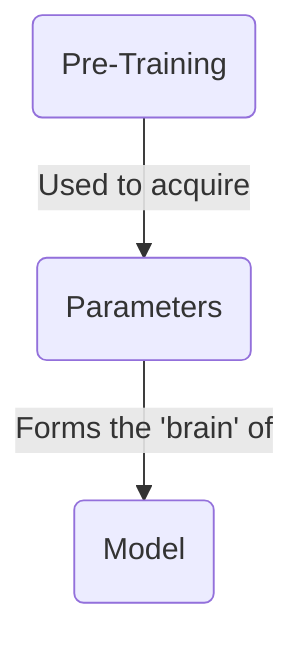
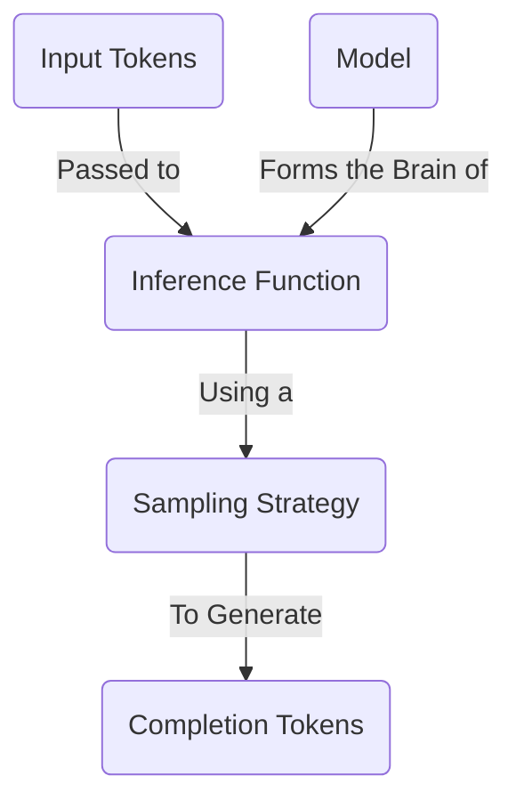
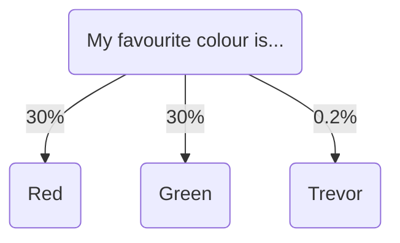
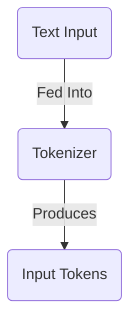
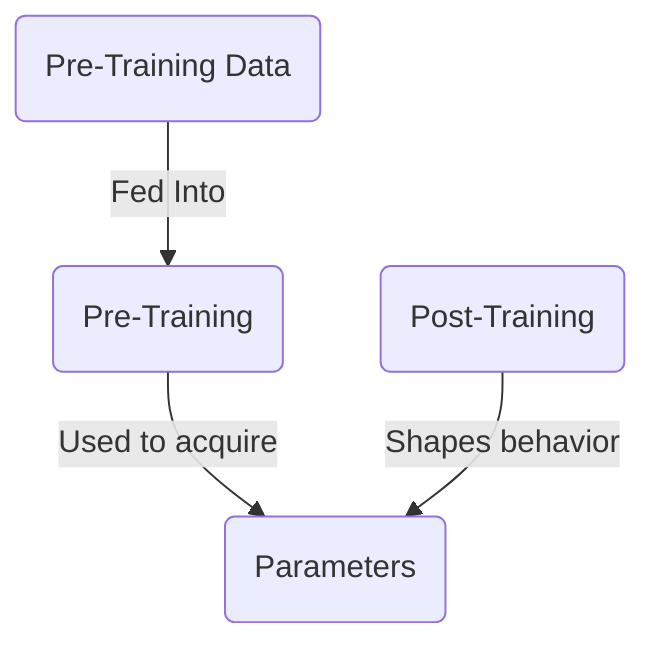
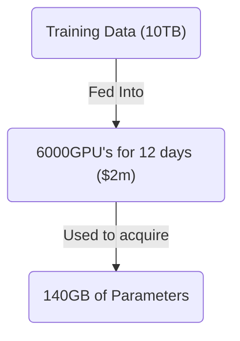
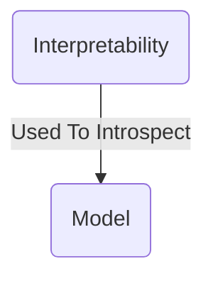

本文将介绍大语言模型的基础知识。我们会讨论它们是什么、如何运作，并简要介绍创建它们的过程。

现有的大多数资料都会非常深入地讲解 LLM 的工作原理——我们不会这样做。相反，我会简要概述最常见的概念，让你可以马上动手构建。

## 什么是大语言模型？



大语言**模型**本质上是一个巨大的压缩文件——可以把它想象成一个 1TB 的 zip 文件。这个文件包含许多数字，以 16 位浮点数编码。这些数字就是模型的**参数**。

```txt
0.1239784871238176123 // Parameter 1
0.1515689756890123123 // Parameter 2
```

这些参数代表模型的“大脑”。它们是模型**预训练**的结果：这个过程接收海量文本数据，并将其“压缩”成这些数字。它们代表模型对世界的理解，并赋予模型记忆事实和做出决策的能力。

这些参数的数量代表模型大脑的大小。通常，大脑更大的模型表现更好，但运行更慢。一个拥有 **70B 参数的模型，运行速度会比拥有 7B 参数的模型慢约 10 倍**。

至此，我们已经看到了规模与速度之间的权衡——这是选择大语言模型时的一个常见主题。

## 如何运行大语言模型？



要让模型做任何有用的事情，你需要对模型执行**推理**。

推理是向模型发送文本并获得响应的过程。这个过程使用**推理函数**来完成——它是一段软件，接收模型的参数，并在这些参数上运行算法以找出下一个词。这比预训练模型便宜得多，而且可以在你的笔记本电脑上完成。

若想深入了解推理的工作原理，请查看[这个精彩的交互式演示](https://bbycroft.net/llm)。

### 采样策略

为了找出下一个词，模型会查看所有可供选择的 Token，并从中选出一个。



为此，它会使用开发者选择的**采样策略**。该策略决定模型如何选择下一个词。最常见的策略包括：

- **贪心采样**：模型总是选择最有可能的词。
- **Top-K 采样**：模型从最有可能的前 K 个词中选择。
- **Top-P 采样**：模型从构成 P% 概率质量的词中选择。
- **温度采样**：模型在选择过程中引入随机性，从而产生更加多样的输出。

详细介绍这些策略超出了本文范围。通常，作为 AI 工程师，你无法更改所用模型的采样策略。不过，你可以调整温度等变量，以获得不同的结果。

## 什么是输入 Token？



当你向模型发送文本时，首先需要对文本进行**分词**。这个过程会把文本拆分成单个词，然后将这些词转换为数字。这些数字就是输入 Token，它们会被传递给推理引擎。

每个模型都有自己的分词器。[Tiktokenizer](https://tiktokenizer.vercel.app/) 是探索不同分词器的绝佳实验场。

## 如何创建模型？



为了获得参数，你需要训练模型。训练大语言模型是一个极其复杂的过程，需要大量时间、专业知识和资金。学习如何训练模型超出了本文范围。

粗略来说，可以取互联网的一部分数据，比如 10TB。使用 6,000 个 GPU 运行 12 天，花费约 $2M。最终得到一个约 140GB 的文件，其中包含模型的全部参数。



训练过程分为两个主要阶段：

1. **预训练**：通过将海量互联网数据压缩成参数，为模型赋予知识
2. **后训练**：通过精心设计的指令和示例塑造模型的个性与行为。

最终，你会得到一个巨大的参数文件——它是模型训练所用全部数据的一种“压缩”版本，并由后训练塑造其个性。没有后训练，模型只会是一团静止的知识——它不知道如何表现得像一个乐于助人的助手。

#### 资源

- Andrej Karpathy 的[大语言模型导论](https://www.youtube.com/watch?v=zjkBMFhNj_g)
- Andrej Karpathy 的[我如何使用 LLM](https://www.youtube.com/watch?v=EWvNQjAaOHw)

## 如何内省模型？



深入模型参数并确定哪些参数对应哪些现实世界概念是可能的（尽管非常困难）。例如，Anthropic 发现模型能够：

- 跨语言共享概念，这表明可能存在某种通用的“思维语言”
- 在写作时提前规划（例如规划诗歌中的押韵）
- 对任务使用多条并行路径（例如心算）
- 有时编造听起来合理的推理，而不是展示其真实思维过程

通过理解模型如何思考，我们可以更好地预判其行为，并有可能消除一些令模型难以获得信任的“魔法”。这可能会在未来带来更可控、更具确定性的 AI 系统——但这项研究仍处于早期阶段。

#### 资源

- Anthropic 的[追踪大语言模型的思维](https://www.anthropic.com/research/tracing-thoughts-language-model)
- Anthropic 的[金门 Claude](https://www.anthropic.com/news/golden-gate-claude)

## 结论

大语言模型将海量知识压缩为数值参数。尽管它们建立在复杂的数学之上，但你不需要理解其内部工作原理，也能有效使用它们。对整体情况有一个基本认识，就足以形成关于其工作方式的良好直觉。

下一篇文章中，我们将探讨如何根据你的具体需求选择合适的 LLM。
