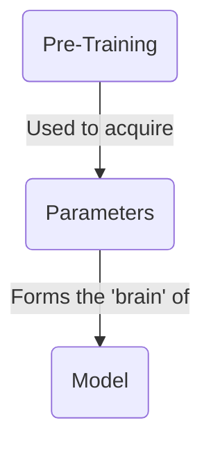
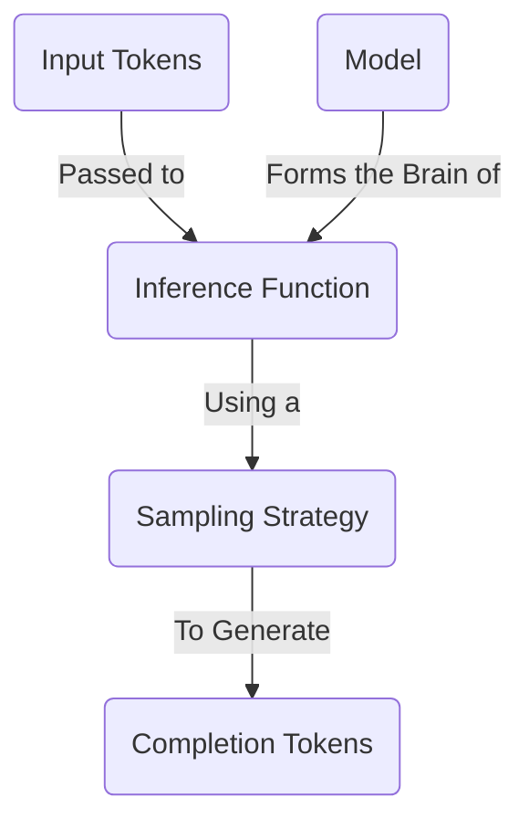
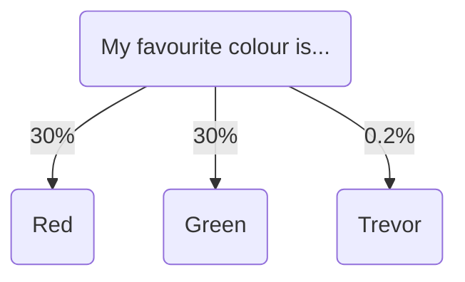
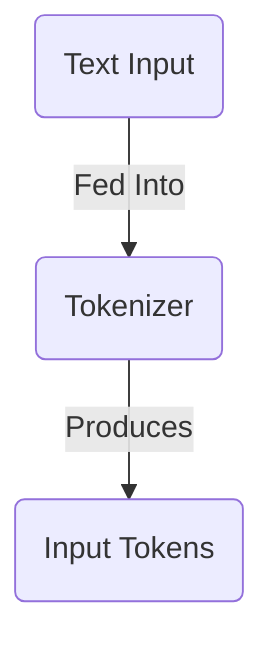
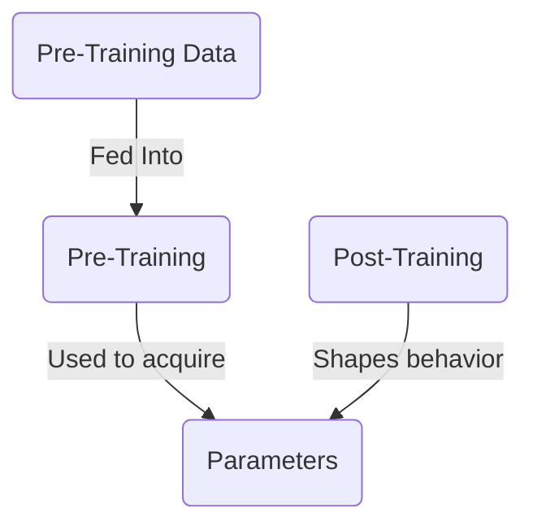
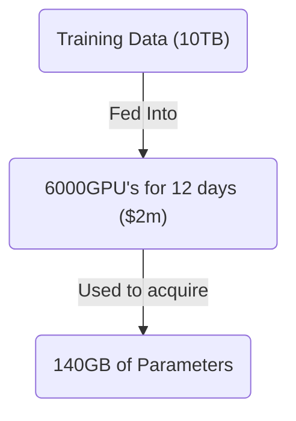
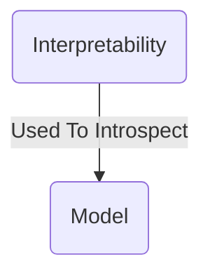

本文将介绍大语言模型的基础知识。我们会讨论它们是什么、如何工作，并简要涉及创建它们的过程。

现有大多数资源对 LLM 的工作原理讲得非常深入——我们不会这样做。相反，我会概述最常见的概念，让你能够直接开始构建。

## 什么是大语言模型？



大型语言**模型**本质上是一个巨大的压缩文件——可以把它想象成一个 1TB 的 zip 文件。这个文件包含一大组以 16 位浮点数编码的数字。这些数字就是模型的**参数**。

```txt
0.1239784871238176123 // Parameter 1
0.1515689756890123123 // Parameter 2
```

这些参数代表模型的“大脑”。它们是模型**预训练**的结果：这个过程接收海量文本数据，并将其“压缩”为这些数字。它们代表模型对世界的理解，并赋予模型记忆事实和做出决策的能力。

这些参数的数量代表模型大脑的大小。通常，大脑更大的模型表现更好，但运行更慢。一个拥有 **70B 参数的模型，运行速度会比拥有 7B 参数的模型慢约 10 倍**。

至此，我们已经看到了规模与速度之间的权衡——这是选择大语言模型时常见的主题。

## 如何运行大语言模型？



要让模型做任何有用的事，你需要对模型执行**推理**。

推理是向模型发送文本并获得响应的过程。这是通过**推理函数**完成的——它是一段软件，接收模型参数并在其上运行算法，以找出下一个词。这比预训练模型便宜得多，并且可以在你的笔记本电脑上完成。

如需深入了解推理如何工作，请查看[这个出色的交互式讲解](https://bbycroft.net/llm)。

### 采样策略

为了找出下一个词，模型会查看所有可选 Token，并选择其中一个。



为此，它会采用由开发者选择的**采样策略**。该策略决定模型如何选择下一个词。最常见的策略有：

- **贪婪采样**：模型始终选择最可能的词。
- **Top-K 采样**：模型从最可能的前 K 个词中选择。
- **Top-P 采样**：模型从概率质量累积达到 P% 的词中选择。
- **温度采样**：模型在选择过程中引入随机性，从而允许更多样的输出。

本文不讨论这些策略的细节。通常，作为 AI 工程师，你无法改变所用模型的采样策略。不过，你可以调整温度等变量以获得不同结果。

## 什么是输入 Token？



当你向模型发送文本时，它首先需要被**分词**。这是将文本拆分成各个词，然后把这些词转换成数字的过程。这些数字就是输入 Token，并会传给推理引擎。

每个模型都有自己的分词器。[Tiktokenizer](https://tiktokenizer.vercel.app/) 是探索不同分词器的绝佳工具。

## 如何创建模型？



要获得参数，你需要训练模型。训练大语言模型是一个极其复杂的过程，需要大量时间、专业知识和资金。如何做到这一点超出了本文范围。

粗略来说，你可以取互联网的一部分，例如 10TB 数据。使用 6,000 块 GPU 训练 12 天，成本约为 $2M。最后会得到一个约 140GB 的文件，其中包含模型的所有参数。



训练过程有两个主要阶段：

1. **预训练**：通过将海量互联网数据压缩进参数，赋予模型知识。
2. **后训练**：通过精心设计的指令和示例塑造模型的个性与行为。

最终会得到一个巨大的参数文件——它是模型所训练全部数据的一种“压缩”版本，其个性由后训练塑造。没有后训练，模型就只是一个惰性的知识块——它不知道如何表现得像一个有帮助的助手。

#### 资源

- Andrej Karpathy 的 [Intro To Large Language Models](https://www.youtube.com/watch?v=zjkBMFhNj_g)
- Andrej Karpathy 的 [How I Use LLM's](https://www.youtube.com/watch?v=EWvNQjAaOHw)

## 如何解读模型？



可以（尽管非常困难）深入模型参数，找出哪些参数对应哪些现实世界概念。例如，Anthropic 发现模型能够：

- 跨语言共享概念，这暗示存在一种通用的“思想语言”。
- 在写作时提前规划（例如在诗歌中规划押韵）。
- 为任务使用多条并行路径（例如心算）。
- 有时会编造看似合理的推理，而不是展示其真实思维过程。

通过理解模型如何思考，我们能够更好地预测它们的行为，并有可能去除一部分使其难以信任的“魔法”。这或许能在未来带来更可控、更具确定性的 AI 系统——但研究仍处于早期阶段。

#### 资源

- Anthropic 的 [Tracing the thoughts of a large language model](https://www.anthropic.com/research/tracing-thoughts-language-model)
- Anthropic 的 [Golden Gate Claude](https://www.anthropic.com/news/golden-gate-claude)

## 结论

大语言模型将海量知识压缩为数值参数。尽管其底层是复杂的数学，但你无需理解内部工作机制，也能有效使用它们。对整体情况有基本认识，便足以建立关于它们如何工作的良好直觉。

下一篇文章中，我们将探讨如何为你的具体需求选择合适的 LLM。
