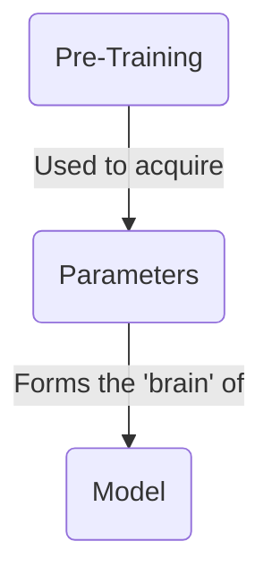
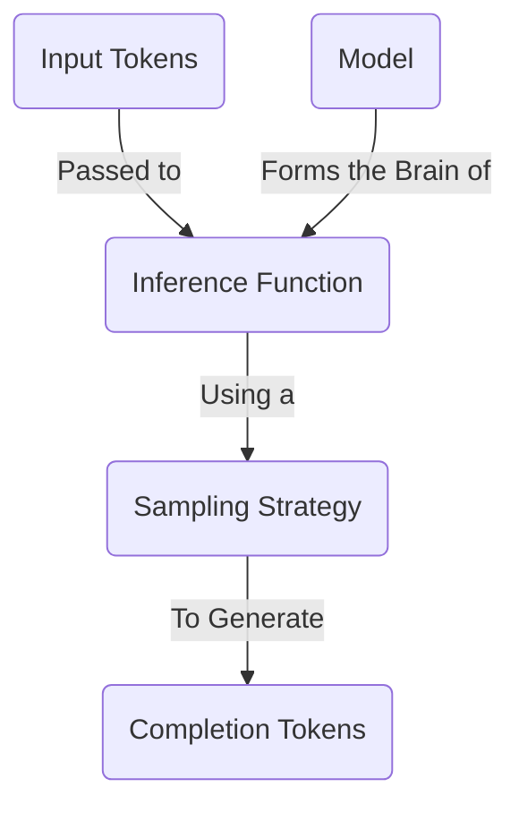
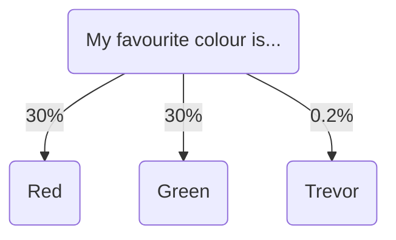
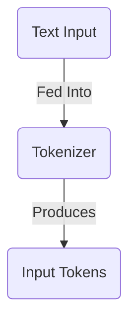
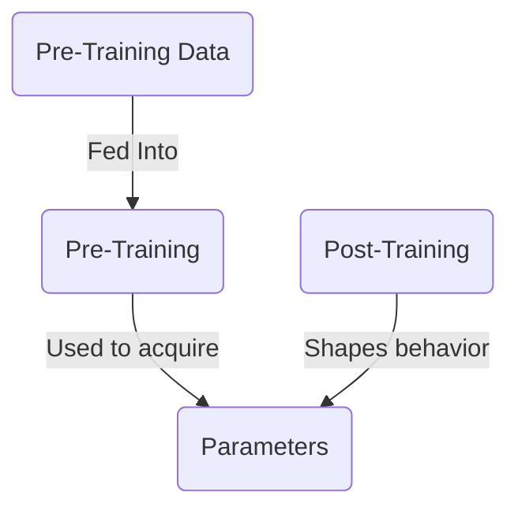
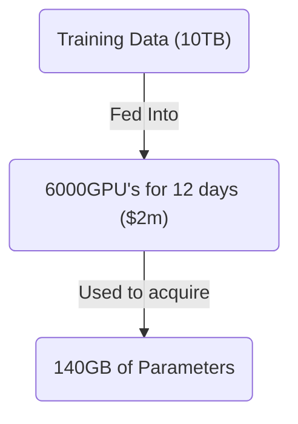
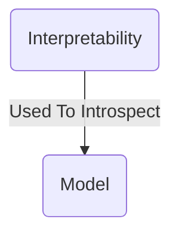

本文将介绍大型语言模型的基础知识。我们会讨论它们是什么、如何工作，并简要涉及创建它们的过程。

大多数现有资源都会非常深入地讲解 LLM 的工作原理——我们不会这样做。相反，我会概述最常见的概念，让你可以直接开始构建。

## 什么是大型语言模型？



一个大型语言**模型**本质上是一个巨大的压缩文件——可以把它想象成一个 1TB 的 zip 文件。这个文件包含大量以 16 位浮点数编码的数字。这些数字就是模型的**参数**。

```txt
0.1239784871238176123 // Parameter 1
0.1515689756890123123 // Parameter 2
```

这些参数代表模型的“大脑”。它们是模型**预训练**的结果：该过程接收海量文本数据，并将其“压缩”为这些数字。它们代表模型对世界的理解，并赋予它记住事实和做出决策的能力。

这些参数的数量代表模型大脑的大小。一般而言，大脑更大的模型表现更好，但运行更慢。一个拥有 **70B 参数的模型，运行速度将比拥有 7B 参数的模型慢约 10 倍**。

我们已经看到了规模与速度之间的权衡——这是选择大型语言模型时的常见主题。

## 如何运行大型语言模型？



要让模型完成任何有用的工作，你需要对模型执行**推理**。

推理是将文本发送给模型并获得响应的过程。这通过**推理函数**完成——它是一段软件，接收模型的参数并在其上运行算法，以找出下一个词。这比预训练模型便宜得多，也可以在你的笔记本电脑上完成。

如需深入了解推理的工作方式，请查看[这份精彩的交互式讲解](https://bbycroft.net/llm)。

### 采样策略

为了找出下一个词，模型会查看所有可选 Token，并从中选择一个。



为此，它使用由开发者选定的**采样策略**。该策略决定模型如何选择下一个词。最常见的策略有：

- **贪心采样**：模型始终选择最可能的词。
- **Top-K 采样**：模型从最可能的前 K 个词中选择。
- **Top-P 采样**：模型从构成 P% 概率质量的词中选择。
- **温度采样**：模型在选择过程中引入随机性，从而允许更多样的输出。

本文不打算深入介绍这些策略的细节。通常，作为一名 AI 工程师，你无法改变所用模型的采样策略。不过，你可以调整温度等变量来获得不同结果。

## 什么是输入 Token？



当你把文本发送给模型时，它首先需要被**分词**。这是将文本拆分为单个词，然后将这些词转换为数字的过程。这些数字就是输入 Token，并会被传递给推理引擎。

每个模型都有自己的分词器。[Tiktokenizer](https://tiktokenizer.vercel.app/) 是一个很棒的练习场，可用于探索不同的分词器。

## 如何创建模型？



要获得参数，你需要训练模型。训练大型语言模型是一个极其复杂的过程，需要大量时间、专业知识和资金。学习如何完成它超出了本文范围。

一个粗略的参考是：取互联网上的一部分数据，比如 10TB 数据。使用 6,000 块 GPU 训练 12 天，成本约为 200 万美元。最终你会得到一个约 140GB 的文件，其中包含模型的全部参数。



训练过程分为两个主要阶段：

1. **预训练**：通过将海量互联网数据压缩为参数，为模型提供知识。
2. **后训练**：通过精心设计的指令和示例塑造模型的个性与行为。

最终会得到一个巨大的参数文件——它是模型训练数据的一种“压缩”版本，并且其个性由后训练塑造。没有后训练，模型只会是一团静止的知识体——它不知道如何像一个有帮助的助手那样行为。

#### 资源

- Andrej Karpathy 的[大型语言模型入门](https://www.youtube.com/watch?v=zjkBMFhNj_g)
- Andrej Karpathy 的[我如何使用 LLM](https://www.youtube.com/watch?v=EWvNQjAaOHw)

## 如何解读模型内部？



可以（尽管非常困难）深入研究模型的参数，弄清其中哪些参数对应哪些现实世界的概念。例如，Anthropic 发现模型能够：

- 跨语言共享概念，这表明存在一种通用的“思维语言”。
- 在写作时提前规划（例如在诗歌中规划押韵）。
- 为任务使用多条并行路径（例如心算）。
- 有时编造听起来合理的推理，而不是展示其真实的思考过程。

通过理解模型如何思考，我们可以更好地预测其行为，并有可能消除部分使它们难以信任的“魔法”。这可能会在未来带来更可控、更确定性的 AI 系统——但这项研究仍处于早期阶段。

#### 资源

- Anthropic 的[追踪大型语言模型的思考](https://www.anthropic.com/research/tracing-thoughts-language-model)
- Anthropic 的[Golden Gate Claude](https://www.anthropic.com/news/golden-gate-claude)

## 结语

大型语言模型将海量知识压缩为数值参数。尽管它们建立在复杂的数学之上，但你无需理解其内部工作原理，也能有效地使用它们。掌握基本全貌，就足以建立对其工作方式的良好直觉。

下一篇文章中，我们将探索如何针对你的具体需求选择合适的 LLM。
