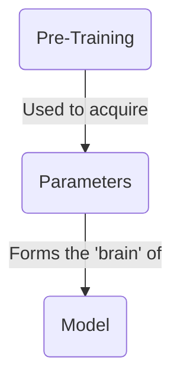
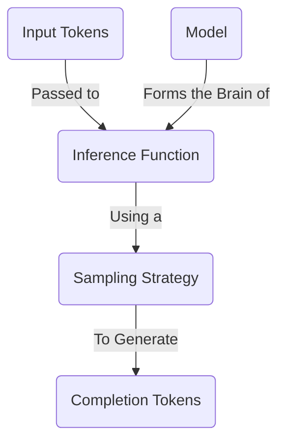
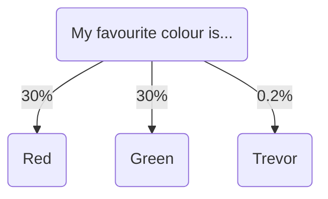
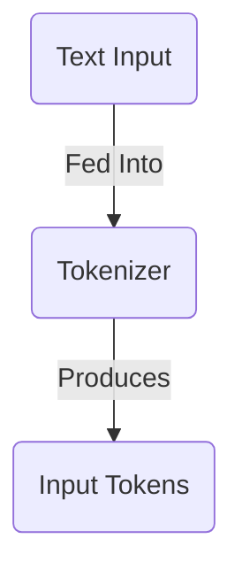
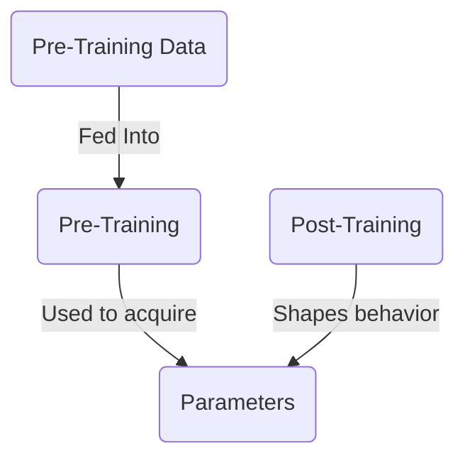
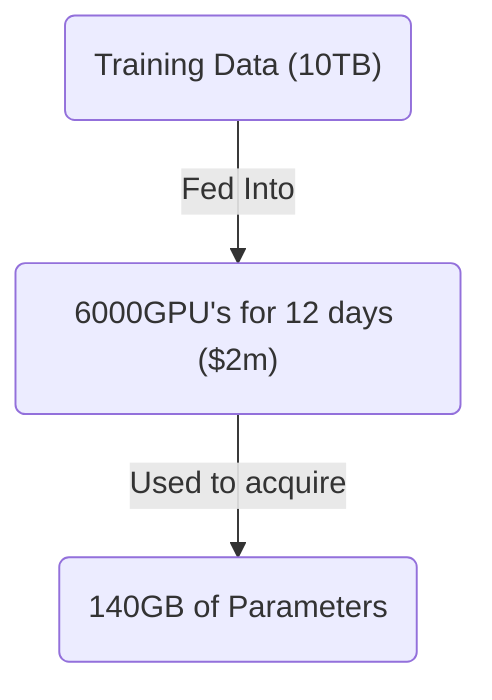
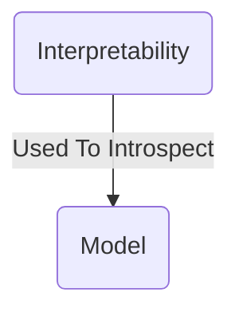

本文会带你了解大语言模型（Large Language Model，LLM）的基础：它是什么、如何运作，以及模型大致是怎样训练出来的。

市面上许多资料会非常深入地讲解 LLM 的工作原理；本文不会走到那么深。相反，我会先梳理最常见的概念，让你能带着基本认识继续动手实践。

## 什么是大语言模型？



大语言**模型（model）**本质上可以理解成一个巨大的压缩文件，类似一个 1TB 的 zip 文件。这个文件保存了大量以 16 位浮点数编码的数字；这些数字就是模型的**参数（parameters）**。

```txt
0.1239784871238176123 // Parameter 1
0.1515689756890123123 // Parameter 2
```

这些参数构成了模型的“脑”。它们来自模型的**预训练（pre-training）**：这一过程把海量文本数据“压缩”进这些数字中。参数承载着模型对世界的理解，也让它能够记住事实、作出判断。

参数数量可以粗略看作模型“大脑”的大小。通常，大脑越大的模型表现越好，但运行也越慢。一个拥有 **700 亿（70B）参数的模型，运行速度大约会比 70 亿（7B）参数的模型慢 10 倍**。

这已经体现了选择大语言模型时常见的一项取舍：模型规模与运行速度之间的平衡。

## 怎样运行大语言模型？



要让模型完成有用的工作，需要对它执行**推理（inference）**。

推理就是把文本发送给模型，再取得它返回的回答。这个过程由**推理函数（inference function）**完成：它是一段软件程序，会读取模型参数并运行算法，找出下一个最可能出现的词。和预训练相比，推理的成本低得多，而且可以在你的笔记本电脑上完成。

想深入了解推理如何工作，可以阅读这份出色的[交互式讲解](https://bbycroft.net/llm)。

### 采样策略

要找出下一个词，模型会查看所有可能选择的 Token，然后从中选出一个。



模型具体怎么选，取决于开发者设定的**采样策略（sampling strategy）**。常见策略包括：

- **贪心采样（Greedy Sampling）**：模型始终选择概率最高的词。
- **Top-K 采样（Top-K Sampling）**：模型从概率最高的前 K 个词中选择。
- **Top-P 采样（Top-P Sampling）**：模型从累计概率占 P% 的那一批词中选择。
- **温度采样（Temperature Sampling）**：模型在选择中加入随机性，从而产生更多样化的输出。

本文不展开讲解这些策略的细节。通常，作为 AI 工程师，你未必能修改所用模型的采样策略；不过可以调整温度（temperature）等变量，得到不同的结果。

## 什么是输入 Token？



当你把文本发给模型时，它首先需要被**分词（tokenized）**。也就是把文本拆分成一个个词或词片段，再把它们转换成数字。这些数字就是输入 Token，会被传给推理引擎。

每个模型都有自己的分词器（tokenizer）。[Tiktokenizer](https://tiktokenizer.vercel.app/) 是一个很好的实验工具，可以用来观察不同分词器如何切分文本。

## 怎样创建一个模型？



要获得这些参数，就需要训练模型。训练大语言模型是一个非常复杂的过程，需要投入大量时间、专业知识和资金；如何亲自训练不在本文讨论范围内。

可以用一个粗略的例子来理解它：取互联网中的一部分数据，例如 10TB；使用 6,000 块 GPU 训练 12 天，成本约为 200 万美元。最终会得到一个约 140GB 的文件，里面保存着模型的全部参数。



训练过程主要分为两个阶段：

1. **预训练（Pre-training）**：把海量互联网数据压缩进参数中，为模型赋予知识。
2. **后训练（Post-training）**：通过精心设计的指令和示例，塑造模型的个性与行为方式。

最终得到的是一个巨大的参数文件：它可以看作模型训练数据的一种“压缩版”，而后训练则塑造了它的行为方式。没有后训练，模型只是一团静态的知识，不知道怎样表现得像一个乐于帮助人的助手。

#### 资源

- Andrej Karpathy 的 [大语言模型入门](https://www.youtube.com/watch?v=zjkBMFhNj_g)
- Andrej Karpathy 的 [我是如何使用 LLM 的](https://www.youtube.com/watch?v=EWvNQjAaOHw)

## 怎样理解模型内部？



我们可以尝试（但这非常困难）深入查看模型参数，弄清哪些参数对应现实世界中的哪些概念。例如，Anthropic 发现模型能够：

- 在不同语言之间共享概念，这暗示它可能具有某种通用的“思维语言”。
- 在写作时提前规划，例如写诗时先规划押韵。
- 为任务使用多条并行路径，例如进行心算。
- 有时会编造听上去合理的推理过程，而不是展示它真正的思考过程。

理解模型如何“思考”，能帮助我们更好地预判它的行为，并有可能减少那些让人难以信任的“神秘感”。这或许会带来更可控、更具确定性的 AI 系统；不过相关研究仍处于早期阶段。

#### 资源

- Anthropic 的 [追踪大语言模型的思考过程](https://www.anthropic.com/research/tracing-thoughts-language-model)
- Anthropic 的 [Golden Gate Claude](https://www.anthropic.com/news/golden-gate-claude)

## 总结

大语言模型把大量知识压缩成数字参数。它们建立在复杂的数学基础上，但要有效使用它们，并不需要先理解全部内部原理。先建立一张基本的“地图”，就足以帮助你形成对它们工作方式的可靠直觉。

下一篇文章会讨论：如何针对自己的具体需求，选择合适的 LLM。

## 中文学习辅助：术语小词典

- **大语言模型（Large Language Model，LLM）**：一种从大量文字中学习规律、能够理解和生成文本的 AI 模型。
- **参数（parameters）**：模型内部的大量数字，可把它们理解为模型从训练资料中学到的“记忆和规则”。
- **预训练（pre-training）**：让模型阅读海量数据、学习语言和常识的初始训练阶段。
- **后训练（post-training）**：在预训练之后继续调整模型，使它更符合人类指令、更安全或更好用的阶段。
- **推理（inference）**：把输入交给已经训练好的模型，并让它生成回答的运行过程。
- **Token**：模型处理文本时使用的基本单位，可能是一个字、一个词或词的一部分。
- **分词器（tokenizer）**：把人类可读的文本切分并转换成 Token 的工具。
- **采样策略（sampling strategy）**：模型从多个可能的下一个 Token 中作选择时所遵循的规则。
- **温度（temperature）**：影响输出随机程度的设置；数值较高通常更有变化，较低通常更稳定。
- **GPU**：适合进行大量并行计算的处理器，是训练大型 AI 模型常用的硬件。
- **可解释性（interpretability）**：研究人员理解模型内部为何会得出某种结果的研究方向。
