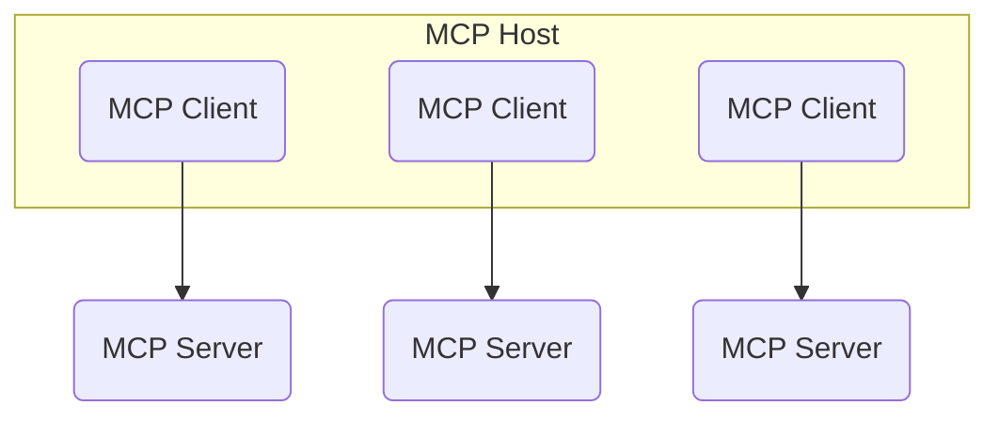
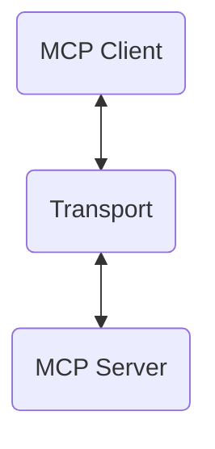
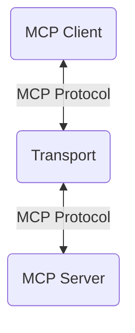

现在，我们已经初步了解 MCP 可以用来做什么，以及它为什么值得关注。接下来，看看它到底怎样工作。

要理解它，我们先要看懂 [Anthropic 发布](https://modelcontextprotocol.io/introduction)的这张 MCP 架构图：


我们一步步来解释。

译注：本篇按 2025 年 3 月的固定原文介绍 MCP。下文的传输方式与消息示例按原样保留，本次未验证它们与当前 SDK 或协议版本的兼容性。

## MCP 宿主与客户端

MCP 宿主（host）是访问 MCP 服务器的程序。它可能是 [Claude Desktop](https://claude.ai/download)、[Cursor](https://cursor.sh/)、[Windsurf](https://codeium.com/windsurf)，也可能是其他支持 MCP 的应用。

宿主通常会使用某种大语言模型（LLM）。这个 LLM 能够调用 MCP 服务器中定义的工具。

一个宿主上会运行多个客户端，每个客户端都与一台 MCP 服务器保持连接关系。宿主启动时，比如你启动 Cursor 时，每个客户端就会连接到一台 MCP 服务器。



所以，一个宿主可以包含多个客户端，每个客户端分别与不同的服务器交互。

译注：图中的 MCP Host、MCP Client、MCP Server 分别是宿主、客户端和服务器。“客户端”在这里是宿主程序内部负责连接服务器的部分，不一定是另一个需要你打开的独立应用。

你也可以构建自己的客户端，我们可能会在后续视频中讲到。现在可以先阅读 [MCP 文档](https://modelcontextprotocol.io/introduction)。

## MCP 服务器

MCP 服务器负责运行宿主想调用的工具。

它既可以在本机运行，也可以运行在远程服务器上。

需要注意的是，服务器和宿主完全可以使用不同的编程语言。就像一个应用的前端与后端可以用不同语言编写一样，宿主和服务器也可以。

译注：前端通常是用户直接操作的界面，后端则负责处理数据和业务。这里用这个例子说明，双方只要遵守通信规则，就不必使用同一种语言。

## 传输方式与协议

客户端通过一种传输方式（transport）连接到服务器。传输方式负责在客户端和服务器之间发送消息。



目前支持两种传输方式。一种是通过 `stdio` 通信，也就是通过终端；另一种是通过 HTTP 的服务器发送事件（server-sent events）通信。如果你想把服务器放到远程机器上，后一种方式就很有用。这两种方式我们后面都会介绍。

译注：`stdio` 指标准输入和标准输出，两个程序可以通过这些输入输出通道交换消息。HTTP 是网络通信协议；服务器发送事件通常简称 SSE。这里的“目前”是原文写作时点。

那通过这些通道传递的消息，到底长什么样？这就是协议要规定的事情。



协议是一组基于 JSON-RPC 2.0 的 JSON 数据结构，客户端和服务器可以按照这些结构互相发送消息。结构如下：

```ts
type Request = {
  jsonrpc: "2.0";
  id: number | string;
  method: string;
  params?: object;
};

type Response = {
  jsonrpc: "2.0";
  id: number | string;
  result?: object;
  error?: {
    code: number;
    message: string;
    data?: unknown;
  };
};
```

请求里包含服务器应执行的 `method`，以及传给该方法的 `params`。

执行成功时，响应里包含 `result`；失败时则包含 `error`。

请求和响应都有一个 `id`，用来把两者对应起来；`jsonrpc` 字段记录底层 `jsonrpc` 协议的版本。

译注：JSON 是一种用字段名和值组织数据的文本格式。方法名告诉对方“做什么”，参数告诉对方“用哪些输入来做”。图中的 MCP Protocol 指这些消息共同遵守的规则，而 Transport 是传递它们的通道。

## 一次通信示例

为了把这个过程讲清楚，我们来看一个例子。假设有个叫 `createGitHubIssue` 的工具，用来在 GitHub 上创建 Issue。

我们略过前面的准备步骤，也就是 MCP 客户端初始化连接的过程，直接从客户端向服务器发送请求开始。

译注：GitHub Issue 是记录任务、问题或讨论的条目。下面的例子展示消息往来，不会实际创建任何条目。

### 1. 列出工具

```json
// Client sends...
{
  "jsonrpc": "2.0",
  "id": 1,
  "method": "tools/list"
}
```

这个请求要求列出服务器上所有可用的工具。服务器会返回工具列表：

```json
// ...server sends back:
{
  "jsonrpc": "2.0",
  "id": 1,
  "tools": [
    {
      "name": "createGitHubIssue",
      "description": "Create a GitHub issue",
      "inputSchema": {
        "type": "object",
        "properties": {
          "title": { "type": "string" },
          "body": { "type": "string" },
          "labels": {
            "type": "array",
            "items": { "type": "string" }
          }
        }
      }
    }
  ]
}
```

注意，服务器返回了工具名称、说明和所需输入。输入用 JSON Schema 描述，其中有标题、正文和标签。

译注：JSON Schema 是描述数据结构与要求的规则。原文把输入称为“所需输入”，但这个示例没有列出 required 字段，因此不要把示意代码当作已经完备的输入校验定义。

### 2. 调用工具

客户端决定调用这个工具，于是发送请求：

```json
// Client sends...
{
  "jsonrpc": "2.0",
  "id": 2,
  "method": "tools/call",
  "params": {
    "name": "createGitHubIssue",
    "arguments": {
      "title": "My Issue",
      "body": "This is the body of my issue",
      "labels": ["bug"]
    }
  }
}
```

这里说明了要调用的工具 `name`，以及传入的 `arguments`。

服务器返回工具的执行结果：

```json
// ...server sends back:
{
  "jsonrpc": "2.0",
  "id": 2,
  "content": [
    {
      "type": "text",
      "text": "Issue 143 created successfully!"
    }
  ],
  "isError": false
}
```

返回值是一个内容片段数组。这些片段可以是上面展示的 `text`，也可以是表示图片的 `image`，或者表示二进制数据的 `resource`。此外，还有一个可选的 `isError` 标志。

如果工具调用出错，返回的对象会略有不同：

```json
// ...if error, server sends back:
{
  "jsonrpc": "2.0",
  "id": 2,
  "content": [
    {
      "type": "text",
      "text": "Error creating issue: Unauthorized"
    }
  ],
  "isError": true
}
```

它告诉客户端，工具调用没有成功。

译注：代码中的 “My Issue” 是“我的 Issue”，“This is the body of my issue” 是“这是我的 Issue 正文”，“Issue 143 created successfully!” 是“已成功创建 Issue 143”，“Error creating issue: Unauthorized” 是“创建 Issue 失败：未获授权”。它们是原始数据与响应示例，保留英文代码并在这里提供中文理解。

译注：上述示例将工具列表和工具结果直接放在响应顶层，与前面 Response 类型中的 result 层级不同。这里保留原文差异，没有擅自改成另一版协议实现；这些示例尚未进行实际客户端兼容性验证。

## 总结

这就是 MCP 工作方式的基本结构。宿主运行客户端，客户端连接服务器，双方通过一种传输方式和一套协议交换消息。
