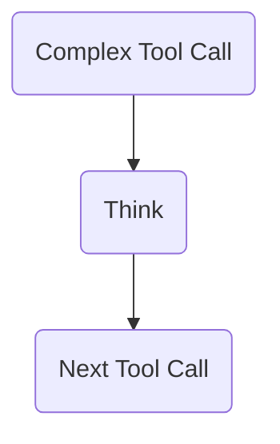

Anthropic 刚发布了一项[新研究](https://www.anthropic.com/engineering/claude-think-tool)，介绍一种简单的方法，帮助 Claude，也可能帮助其他 LLM，处理需要复杂问题求解的任务。

方法很简单：给 LLM 提供一个可以调用的“think”工具。

想知道工具是什么？可以看看[这套教程](/vercel-ai-sdk-tutorial)（[英文原文入口](https://www.aihero.dev/vercel-ai-sdk-tutorial)）。

原理是，在作出决定前，让 LLM 有机会思考一下。它提供了一种有结构的方式，让模型先回顾已有信息，再继续行动。



译注：图中是“复杂工具调用 → 思考 → 下一个工具调用”的顺序。

这样，LLM 可以把重要信息保留在上下文中，之后用来作更好的决定。它与 ReAct、Reflexion 等熟悉的思路相呼应。

来实现一下。

译注：本篇保留原作者 2025 年 3 月的接口与研究介绍。本次没有运行工具或验证效果；这个示例记录的是模型显式提交的工具参数，并不代表可以读取现有模型未公开的内部推理。原文没有提供具体任务输入、完整依赖和访问配置。

## 提示词

先提取出一个 `description` 变量，作为工具的说明：

```ts
const description = `
Use the tool to think about something.
It will not obtain new information or change the
database, but just append the thought to the log.
Use it when complex reasoning or some cache memory
is needed.`;
```

中文 Prompt（译注）：

```text
使用这个工具思考某件事。
它不会获取新信息，也不会修改数据库，
只会把想法追加到日志中。
需要复杂推理或一些临时记忆时，使用它。
```

这段文字来自 Anthropic 的文章。

## 工具

<Scrollycoding>

# !!steps

先写一次 AI SDK 的 `streamText` 调用：

```ts ! example.ts
import { streamText } from "ai";

const result = await streamText({});
```

# !!steps

使用 Claude 3.7，并把 `maxSteps` 设为 10：

```ts ! example.ts
import { anthropic } from "@ai-sdk/anthropic";
import { streamText } from "ai";

const result = await streamText({
  model: anthropic("claude-3-7-sonnet-20250219"),
  maxSteps: 10,
});
```

# !!steps

接着，传入一个名为 `think` 的工具，使用刚才定义的 `description`：

```ts ! example.ts
import { anthropic } from "@ai-sdk/anthropic";
import { streamText } from "ai";

const result = await streamText({
  model: anthropic("claude-3-7-sonnet-20250219"),
  tools: {
    think: {
      description,
    },
  },
  maxSteps: 10,
});
```

# !!steps

添加 `parameters` 对象，把它交给 `think` 工具。

其中包含一个字符串字段 `thought`，字段说明同样来自原文章。

```ts ! example.ts
import { anthropic } from "@ai-sdk/anthropic";
import { streamText } from "ai";
import { z } from "zod";

const result = await streamText({
  model: anthropic("claude-3-7-sonnet-20250219"),
  tools: {
    think: {
      description,
      parameters: z.object({
        thought: z
          .string()
          .describe("A thought to think about."),
      }),
    },
  },
  maxSteps: 10,
});
```

译注：字段说明 “A thought to think about.” 的意思是“一个要思考的想法”。

# !!steps

最后，添加 `execute` 函数，把它交给 `think` 工具。

这个函数不做其他操作，只返回传给它的 `thought`。

这段内容就会留在上下文中，模型后续继续运行时，可以用它作更好的决定。

```ts ! example.ts
import { anthropic } from "@ai-sdk/anthropic";
import { streamText } from "ai";
import { z } from "zod";

const result = await streamText({
  model: anthropic("claude-3-7-sonnet-20250219"),
  tools: {
    think: {
      description,
      parameters: z.object({
        thought: z
          .string()
          .describe("A thought to think about."),
      }),
      execute: async (args) => {
        return {
          thought: args.thought,
        };
      },
    },
  },
  maxSteps: 10,
});
```

</Scrollycoding>

译注：原工具说明提到“追加日志”，但这里展示的实现只返回 thought 对象，没有写入独立日志文件。代码按原样保留，不额外增加文件操作。maxSteps 是原例中的步骤上限。

## 总结

这样，我们就在 Claude 3.7 Sonnet 中实现了“think”工具。

在一些场景中，这个方法很有用。Anthropic 推荐将它用于“需要遵循规则，并在较长工具调用链中进行推理的复杂任务”。只需给现有 LLM 实现添加几行简单代码，就可能带来有意义的改善。

祝你实验顺利！
