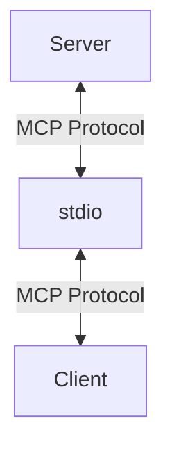
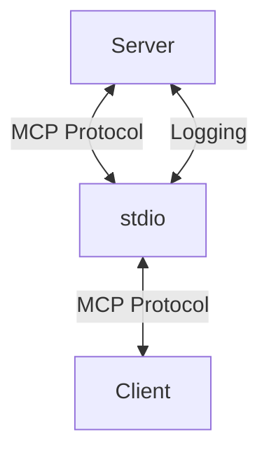
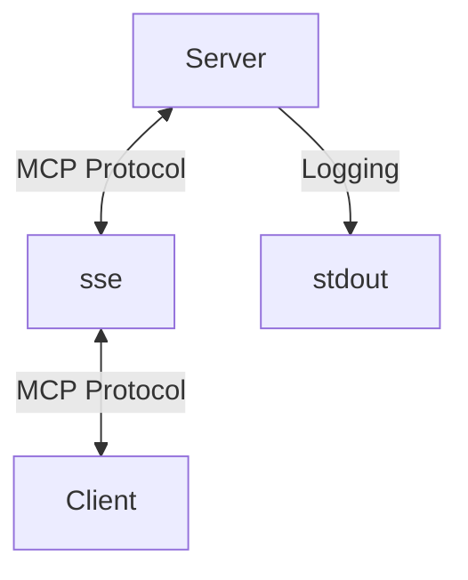

使用 MCP 服务器的 `stdio` 传输方式时，有个特别容易踩中的坑。

那就是：控制台日志不能照常使用。

## 为什么 `console.log` 行不通？

MCP 服务器其实就是一个普通的 Node 应用。客户端启动 MCP 服务器，然后监视服务器的 `stdout`，从中读取 MCP 消息；发送回服务器的 MCP 消息则写入它的 `stdin`。



但是，Node 应用也会把 stdio 用于另一个目的：记录日志。向控制台打印日志时，你正在写入 MCP 服务器与客户端通信所使用的同一条数据流。



这意味着，在服务器中向控制台输出日志，会让客户端收到不符合 MCP 格式的消息。具体后果取决于客户端，有时可能导致它崩溃。即使没有崩溃，读取这些消息的程序至少也会把日志吞掉。

译注：stdout 是标准输出，stdin 是标准输入。图中的 Server 是服务器，Client 是客户端，Logging 表示日志。在这个通信方式中，普通日志会混进原本只该放协议消息的输出通道。

## 为什么 `sse` 没有这个问题？

`sse` 传输不会遇到这个问题，因为它不通过 `stdio` 传递消息：



所以，它可以自由地使用 `stdout` 记录日志。

`sse` 完全可以在本机使用。如果读取控制台日志对你很重要，你可能更愿意采用这种方式。

译注：SSE 是服务器发送事件，一种通过 HTTP 发送事件消息的方式。本篇保留原文所讨论的传输方案，没有对当前版本作运行验证。

## 怎样记录日志？

我偏好的办法是创建一个自定义日志工具，把内容写入本地文件 `mcp-server.log`。下面是我的实现：

```ts
// 1. appendFileSync
import { appendFileSync } from "fs";
import { join } from "path";

// 2. LOG_FILE
const LOG_FILE = join(
  import.meta.dirname,
  "mcp-server.log",
);

// 3. formatMessage
function formatMessage(
  level: string,
  message: string,
  data?: unknown,
): string {
  const timestamp = new Date().toISOString();
  const dataStr = data
    ? `\n${JSON.stringify(data, null, 2)}`
    : "";
  return `[${timestamp}] [${level}] ${message}${dataStr}\n`;
}

// 4. logger
export const logger = {
  log(message: string, data?: unknown) {
    const logMessage = formatMessage(
      "INFO",
      message,
      data,
    );
    appendFileSync(LOG_FILE, logMessage);
  },
  // ...
};
```

1. 用 `appendFileSync` 同步写入文件。
2. 定义日志文件的路径。
3. 定义一个格式化日志消息的函数。
4. 导出一个日志工具对象，它的 `log` 方法会把内容写入日志文件。你还可以导出 `error`、`warn` 等其他方法。

这样，就能把日志保存到文件中，同时不干扰 MCP 协议。

译注：“同步写入”表示程序在这次文件写入完成后才继续往下执行。原例末尾的省略注释说明这里只展示了部分日志方法。运行所需的 Node 版本、文件写入权限和完整项目环境未在原文中给全，本次没有执行该代码。

## 一种可能的替代办法：通知

有位读者提醒我，MCP 其实有“通知”的概念，只是在[文档](https://modelcontextprotocol.io/docs/concepts/architecture#message-types)里藏得有点深。

理论上，它允许服务器主动给客户端发送消息。

不过，具体怎样实现由客户端决定，所以能否用它记录日志，还没有定论。

如果有人用过通知来记录日志，我很想在 [Discord 原站入口](https://www.aihero.dev/discord)听听你的经验。

## 另一种可能的替代办法：`stderr`

还有人告诉我，输出到 `stderr` 的日志，也就是用 `console.error` 打印的内容，不会被 MCP 客户端读取。

这意味着，你或许可以用 `tee` 分流运行 MCP 服务器的进程输出，把日志写入文件。

我很快会详细介绍这一点，目前先把它看作一项 TODO。

译注：stderr 是标准错误输出，独立于 stdout；tee 常用于一边保留输出、一边将它写入文件。原文把这个方案列为待进一步说明的可能办法，没有提供完整命令，本次也没有补写成已验证教程。

## 总结

考虑 MCP 服务器日志时，有两种选择：

- 使用不占用 `stdout` 的传输方式，比如 `sse`。
- 把日志写入 `.log` 文件。
