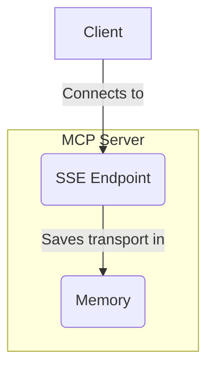
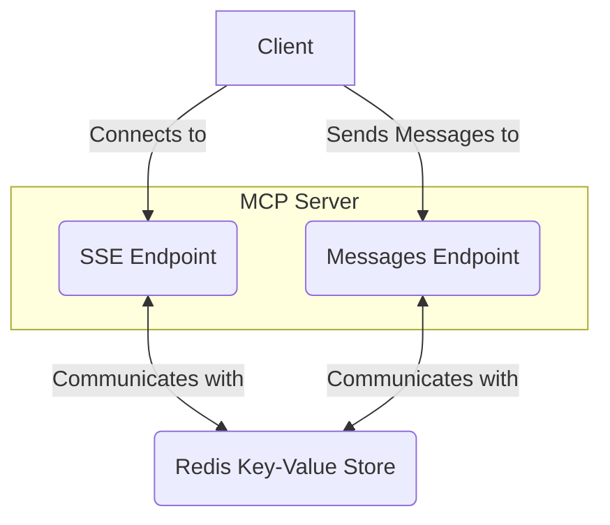

在[之前的例子](https://www.aihero.dev/serving-mcp-servers-over-http)里，我们创建了一个可以通过 HTTP 提供服务的简单 MCP 服务器。

**但它有一些缺点。**

译注：本篇讨论的是 2025 年 3 月原文所示的 SSE 服务器实现。代码、作者判断及建议按原文保留，未验证当前 MCP 版本或实际部署。前篇链接保留原站入口，不代表本次已经取得那一篇的完整中文页。

## 一次只能服务一个客户端

最明显的问题是，**它一次只能服务一个客户端**。当前的“传输对象”保存在一个变量中：

```ts
import { SSEServerTransport } from "@modelcontextprotocol/sdk/server/sse.js";
import express from "express";

// The transport variable
let transport: SSEServerTransport | undefined =
  undefined;

const app = express();

app.get("/sse", async (req, res) => {
  transport = new SSEServerTransport("/messages", res);
  await server.connect(transport);
});
```

这意味着，**如果第二个客户端连接进来，第一个客户端就会断开连接**。

译注：客户端是向服务器发请求的一方。变量就像程序中一个有名字的存储位置；这里的新连接会覆盖之前保存在同一位置的传输对象。

## 有状态服务器

不过，假设我们修好了这个问题。我们不再把传输对象放进一个变量，而是给每个对象配一个 ID 保存起来，之后按 ID 取出。

即使这样，仍然有一个问题。

**这种做法要求服务器保留状态**。我们必须在内存中持续记录这些传输对象。如果服务器进程退出，它们就会丢失。



译注：图中 SSE Endpoint 是接收 SSE 连接的入口，Memory 是内存；箭头表示服务器把连接的传输对象留在内存里。“有状态”在这里指服务器必须记住先前连接留下的信息，后续才能继续工作。

这限制了服务器的部署方式。**Vercel 或 AWS Lambda 这样的 serverless 环境就不适用**，因为它们会在请求之间丢弃内存状态。

我们需要把它部署到一台**持续运行的服务器**上，比如 VPS。

译注：Serverless 是由平台按需管理运行资源的方式，VPS 则是可由你管理的虚拟服务器。上面关于平台限制的判断针对作者这里需要持续内存状态的方案，不是本次对所有平台和版本作出的实测结论。

## 把状态保存在 Redis 中

更好的办法是**把状态存进数据库**。我们可以使用 Redis 这样的键值存储。



译注：键值存储可以理解为用一个名字或编号查找对应内容的数据库。图中 SSE 入口和 Messages 消息入口都与 Redis 通信；客户端先连接 SSE 入口，再向消息入口发送消息。

现在，传输信息保存在 Redis 中，**服务器自身就可以不保留状态**，也就能部署到 serverless 环境。

## Vercel 示例

`mcp-on-vercel` 采用的就是这种方式。我建议你**查看[它的仓库](https://github.com/vercel-labs/mcp-on-vercel)**，进一步了解实现。

虽然这个仓库是为 Vercel 设计的，但**也可以调整后用于其他 serverless 平台**。

## 总结

MCP 服务器本质上是有状态的。不过，把状态保存在数据库中，就可以将它们部署到 serverless 环境。

这是我推荐的生产环境 MCP 服务器部署方式。

但这也引出了一个问题：有没有办法在设计协议时，就让服务能够无状态运行？

还要额外接入一个键值存储，让我觉得负担有些多余。难道不能让客户端保存状态吗？

我会在以后的文章里继续探讨。

译注：以上建议和提问属于原作者在该版本背景下的观点。本次没有部署 Redis、服务器或配套仓库，也没有把尚未取得的后续文章补写进来。
