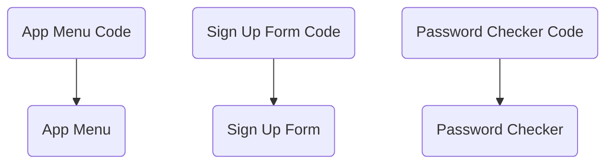
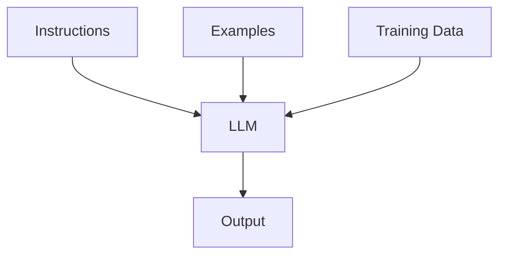
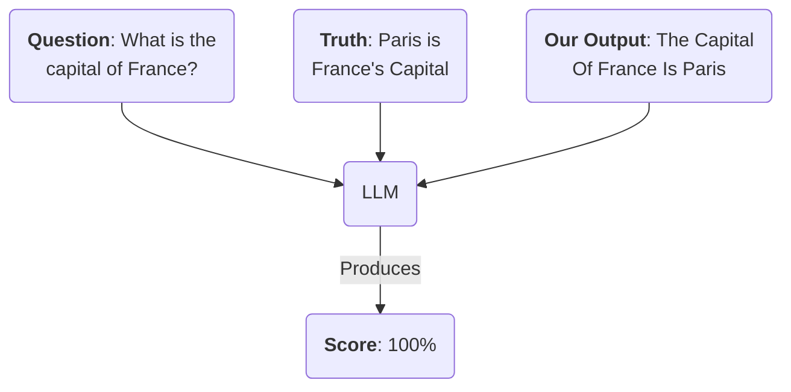

正如[上一篇文章（中文）](/the-ai-engineer-mindset)（[英文原文](https://aihero.dev/the-ai-engineer-mindset)）所说，用 LLM 构建应用，需要从根本上改变你看待软件开发的方式。你不再是在设计输入会对应可预测输出的确定性系统，而是在面对本来就难以预测的概率系统。

管理这种不确定性的关键工具是 evals，也就是评估。评估就像 AI 工程师的单元测试，帮助你从概率系统中获得一定的可预测性。任何 AI 应用想达到生产要求，都离不开它。

我们来看看评估是什么，以及 AI 应用为什么如此需要它。

译注：单元测试通常用来检查一小段程序是否符合预期。评估则用一组例子和评分标准来观察 AI 系统表现，不一定只有“通过”或“失败”两种结果。本页保留固定原文及工具介绍，未运行示例或核实当前产品限制。

## 为什么传统测试不够？

传统软件测试依赖输入和输出之间确定的关系，每个组件都有明确的职责：



译注：图中三组关系依次是菜单代码对应菜单、注册表单代码对应注册表单、密码检查代码对应密码检查功能。

但 LLM 系统不同，每份输入都要经过难以预测的复杂转换过程：



译注：指令、示例和训练数据共同影响 LLM，最后产生输出，分别对应图中的 Instructions、Examples、Training Data 和 Output。

在 AI 系统里，没有哪种改动一定很小。它们的注意力和转换机制难以看透。即使把蝴蝶“flaps”翅膀改成“Flaps”翅膀，也可能改变输出。说得保守一点，要用它们构建稳健的系统，必须小心。

译注：这里用同一个英文词首字母大小写的变化作比喻，说明细小输入差异也可能影响结果。

## 只靠人工 QA 不够

很快做出一个令人印象深刻的 AI 演示并不难，但让它成为可靠的正式产品并不容易。

尤其难的是，判断改动究竟让应用变好了还是变差了。你改一下，试几个自己喜欢的提示词，再看它是否“感觉更好”。这种做法很危险。

确定性软件通常还可以只靠人工质量检查。你说“我加了一个新页面”，QA 团队就能细致地测试新页，再对旧页做基本检查。

但在概率系统里，这种方法会让你陷入麻烦。任何改动都可能影响整个系统，你必须有办法知道它是在变好还是变差。

对于换模型或重新设计提示词这样的大改动，这一点尤其重要。

## 评估

关键是自动化。每次修改应用，或底层模型发生变化时，都需要评估应用。

### 传统的确定性系统

在确定性系统中，自动测试相对直接。输入一些内容，然后检查输出即可。

```ts
const output = myNormalSystem(input);

// Will fail if the output doesn't match
assert(output === "my-desired-output");
```

这些断言只有“通过”或“失败”。通常，应用需要通过全部测试，才算可以投入生产。

译注：断言是程序中的检查条件，不满足条件就报告失败。

### 概率系统

给 AI 写这样的测试，却没有那么简单。

假设应用会生成文章，你想检查输出是否达到了发布要求，可能需要检查：

- **事实准确性**：输出中的所有陈述是否符合事实。
- **写作风格**：文字是否流畅、写得好。
- **提示词遵循程度**：输出是否确实回应了用户要求。

这些都是定性指标。它们需要用分数表示，而不只是通过或失败。每次改应用，你要知道它让系统提升了 5%，还是变差了 50%。

这就是评估的作用：给你一个分数，用来观察 AI 系统表现如何。

## 三种评估

AI 系统主要有三类评估方式。

### 确定性评估

**确定性评估**可以写成简单断言。

```ts
const article = writeArticleWithLLM(prompt);

// Article should be more than 300 words long
assert(article.length >= 300);

// Article should be less than 2,000 words long
assert(article.length <= 2000);
```

译注：原注释说的是文章“单词数”，但若 article 是 JavaScript 字符串，length 计算的是字符串长度，不是英文单词数。这里保留原代码并指出差异，没有把它改造成已验证的字数统计实现。

这是传统的通过或失败检查。你会给系统输入多种提示词，每次都检查是否通过这些测试。

它们很容易写，但只能覆盖你想评估的一部分内容。

### 人工评估

对于更依赖概率和判断的指标，你有两种选择。

一种是由人来检查系统表现是否正确。在早期没有多少数据时，这通常是唯一的选择。

它昂贵，也耗时，但所有 AI 系统都在某种程度上依赖人的参与。

### 让 LLM 当评委

另一种方法，是把提示词产生的结果交给另一个 LLM，让它充当评委。这是当前很流行的一种评估方式。

假设你想确认应用是否在说真话，就可以把系统输出和一份正确事实一起交给 LLM。



图中问题的中文 Prompt（译注）：

```text
法国的首都是哪里？
```

中文理解：系统输出是“法国的首都是巴黎”，参考事实是“巴黎是法国的首都”，LLM 给出的示例分数是 100%。这里是原文图示，不是本次评估所得分数。

实际例子可以在 [Evalite 文档](https://www.evalite.dev/guides/scorers#creating-llm-as-a-judge-scorers)中找到。

让 LLM 当评委，使一些评估成为可能，但也有成本。运行 LLM 并不便宜，因此要仔细考虑执行频率。例如，每次文件变化都跑一遍评估，费用可能高得难以承受。

常见做法是把评估分成两组：较小的一组用于本地测试，较大的一组每天运行。

## 怎样持续改善评估？

评估是监测和改进 AI 系统的方法，因此，用来评估的数据集也非常重要。

你要确保测试数据能代表系统在生产中真正会遇到的情况。比如做分类器时，评估应覆盖系统可能遇到的各种边界情况。

所以，在应用中加入可观察性和反馈系统很重要。部署之后，用户会判断系统是否有用。点赞、点踩这样的简单反馈按钮，就能带来非常有价值的信息。

译注：可观察性是通过日志、指标等信息了解系统实际运行情况的能力。收集和使用用户数据仍需相应授权，并遵守隐私要求。

### 数据带来的持续改进循环

[v0](https://v0.dev/) 的开发者 Vercel 写过 [AI Native Flywheel](https://vercel.com/blog/eval-driven-development-build-better-ai-faster#the-ai-native-flywheel)，解释评估在 AI 开发过程中的重要性。

最好的评估数据来自用户。仔细观察用户怎样使用应用，就能建立反馈循环，让系统持续改进。举个例子：

- **用户要求**应用：“build me a classy React application”。
- **应用**生成了 React 代码。但它没有把界面做得“有格调”，而是在代码中使用了类。
- **用户点踩**，也许还会留言解释原因。
- 你把 “build me a classy React application” 这个提示词做成**新的评估用例**，加入评估集。
- 你**改进系统**，直到它通过这个评估。
- 你**重新部署**。下次用户使用这个提示词，就能得到更好的回复。

中文 Prompt（译注）：

```text
为我构建一个有格调的 React 应用。
```

译注：这个例子利用了英文 classy 与 class 的关联。Classy 在请求中是“有格调”，程序却把它理解成了代码中的“类”。React 是构建用户界面的工具；类是程序组织代码的一种方式，两者的“好看”和“用了类”不是一回事。

这就是数据带来的改进循环。持续观察系统，并加入反馈机制，就能让它不断进步。

## 怎样运行评估？

运行评估有很多方法。许多初创公司已经进入这个领域，提供执行评估和在线查看结果的工具。

[Braintrust](https://braintrust.dev/) 是一个流行选择。它提供云平台来运行评估、与团队分享结果，也有许多其他功能。你可以用它的 SDK 通过 TypeScript 编写评估。不过，它对评估有限速，快速迭代时可能让人沮丧。

我维护着一个叫 [Evalite](https://www.evalite.dev/) 的库，它是基于 TypeScript 测试工具 [Vitest](https://vitest.dev) 的轻量评估执行器。

Evalite 的设计目的是让你在本地运行评估。它不附带云平台，因此你想多频繁运行都可以。如果你刚刚开始，它是个不错的选择。

译注：这些产品描述按固定原文保留，当前功能与限额未核实。本地执行工具本身没有云平台，不代表它调用的模型 API 没有费用或限制。

## 评估实际怎样工作？

可以把评估想成一个函数：

```ts
const score = runEval({
  // 1. The prompts we'll test with
  data: [
    "Fish species in the Mediterranean",
    "Story of the first Moon landing",
    "Are Krakens real?",
  ],
  // 2. A function to generate outputs based
  // on our prompts
  task: async (topic) => {
    return generateArticle(topic);
  },
  // 3. The scorers we'll use to generate
  // the final score
  scorers: [
    // Checks if output is long enough
    length,
    // Uses an LLM to check if it's accurate
    factualAccuracy,
    // Uses an LLM to check writing style
    writingStyle,
  ],
});

// 4. A score between 0-100%
console.log(score);
```

代码中三个主题输入的中文 Prompt（译注）：

```text
地中海的鱼类物种
首次登月的故事
克拉肯海怪真的存在吗？
```

我们传入一组提示词（1）、要执行的任务（2），以及用来给输出打分的方法（3）。

最后，得到一个分数，说明函数表现如何（4）。

译注：length 评分器检查长度，factualAccuracy 检查事实准确性，writingStyle 检查写作风格。原文没有给出 generateArticle、runEval 或这些评分器的完整实现，本次也没有运行此代码；它是结构示例，不是开箱即用的程序。

这就是评估的核心。这里的 API 大致参考了 Braintrust 的 [autoevals 库](https://github.com/braintrustdata/autoevals)。

## 关键就是评估！

下面这张图基于 Vercel 的 AI Native Flywheel，展示评估如何影响应用。


[深色版本原图](https://res.cloudinary.com/total-typescript/image/upload/v1742902084/aihero.dev/ai-roadmap/what-are-llms-useful-for/dark/It_s_The_Evals_Stupid_otd3h5.svg)

评估应该处在反馈循环的中心。随着更多用户接触应用，也就是分发扩大，他们会通过使用带来更多数据。你可以用数据改进应用，再重新运行评估。

这些评估让你能应对新技术和新模型，持续改善应用。

译注：原 ThemeImage 的浅色和深色资源均保留，原尺寸为 808 × 545。本页没有把图中的持续改进过程声称为自动执行的流程。
