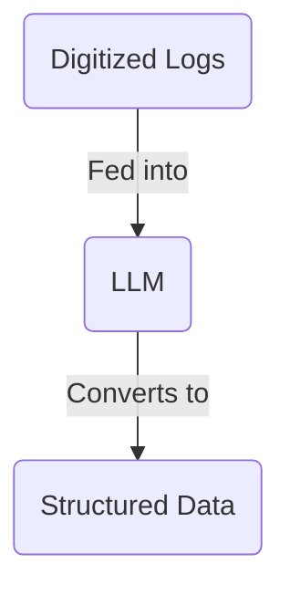
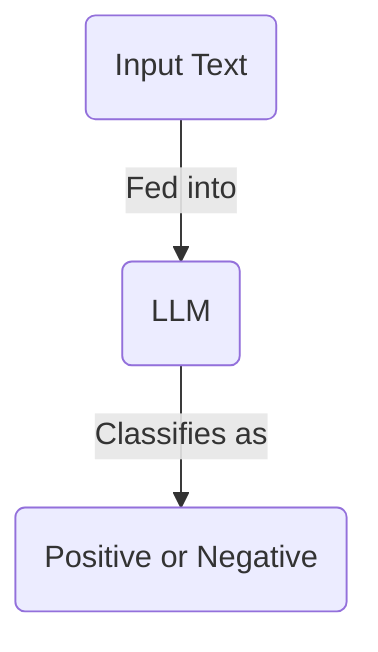
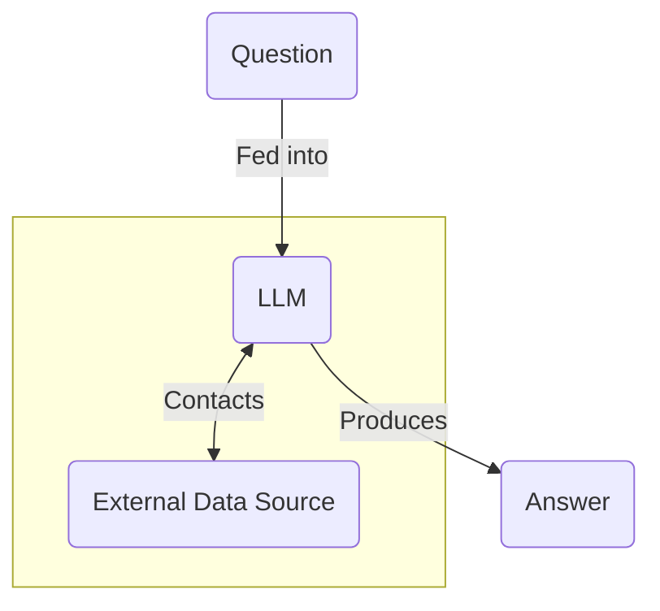
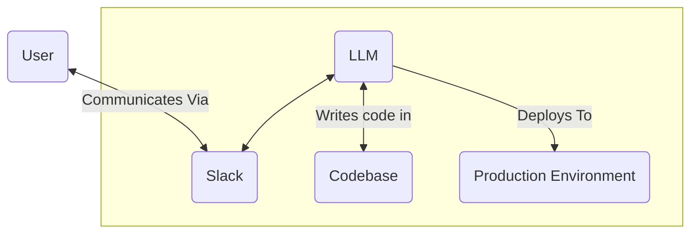

深入了解 LLM 及其工作原理之前，我们先要弄清楚方向。

如今，LLM 实际上用来做什么？它们有什么用？你能用它们构建什么？

这篇文章会介绍 LLM 的不同用途，也会讨论哪些东西不应该用 LLM 构建，因为它们更适合交给结果确定的工具。

译注：“确定性”指在相同条件和输入下，程序按固定规则得到相同结果。本篇的产品例子和发展判断保留 2025 年 3 月原文时点，不是本次重新核实的行业近况。

## 适合用 LLM 做的事

### 把非结构化数据转换成结构化数据

大多数公司都掌握着大量非结构化数据，例如客服通话转录、客户邮件、发票，甚至只是会议笔记。

这些数据很难处理，不容易搜索、分析，也不容易阅读。

比如，我的一位朋友开始攻读博士，研究历史上的鹰类迁徙模式。关于这些鹰怎样迁徙的数据，保存在 19 世纪的老旧非结构化日志中。尽管这些日志已经仔细归档并完成数字化，逐份阅读仍然极其耗时。

怎么办？用 LLM 把日志转换成表格数据。LLM 可以阅读日志、理解其中的模式，再转换成结构化格式。之后，就能用这些数据进行分析、可视化和进一步研究。

译注：非结构化数据没有统一的字段和排列方式；结构化数据则像表格，每列有明确含义。图中 Digitized Logs 是数字化日志，LLM 将它们转换成 Structured Data，也就是结构化数据。

这可能是 LLM 最常见、最有用的用途。过去几十年，世界积累了海量数据，LLM 正让这些数据变得可以检索和利用。

这也是一个常见特点：LLM 经常用于那些靠雇人完成并不现实、或者成本过高的数据任务。过去难以利用的数据，因此有了新的处理可能。

### 打标签与分类

另一个常见任务是分类。你可以给 LLM 一份输入，让它贴上标签，以便更有效地组织和理解数据。

[《提示词报告》（中文）](/the-prompt-report)（[英文原文](https://www.aihero.dev/the-prompt-report)）里有个值得注意的例子。研究者在案例中尝试识别“可能有自杀倾向者所写文本中，能够预测危机级别自杀风险的信号”。他们使用了 Reddit 的 [r/SuicideWatch](https://www.reddit.com/r/SuicideWatch/) 社区数据，要求 LLM 的判断与专家分析相符。

给出文本后，LLM 要判断其中是否有 “frantic hopelessness” 或 “entrapment”，也就是强烈到近乎慌乱的绝望感，或者被困住、无路可走的感觉。它会回答 “positive”，表示文本里有风险信号，或回答 “negative”。

译注：图中是输入文本交给 LLM 后被判为阳性或阴性的分类过程。这里介绍的是原文的研究案例；这种标签不等于临床诊断，也不能凭一次模型输出认定某个人的安全状况。

机器学习早就有分类系统，但通常需要大量训练数据。LLM 让这件事变得更容易，只要一段简单的提示词，就能让它按分类器的方式工作，非常实用。

LLM 最近的发展也让结构化数据更容易取回。可以看看 Vercel AI SDK 教程里的[分类示例（中文）](/generate-enums-with-vercel-ai-sdk?list=vercel-ai-sdk-tutorial)（[英文原文](https://www.aihero.dev/generate-enums-with-vercel-ai-sdk?list=vercel-ai-sdk-tutorial)）。

### 回答问题

另一个常见用途是回答问题。你把问题交给 LLM，它会根据训练数据给出回复。

不过，把 LLM 当知识库有几个缺点。训练数据有截止日期，它无法直接取得更新的信息；回答也常常无法给出来源，因而很难验证是否准确。

所以，把 LLM 连接到外部数据源是一种常见做法。

外部数据源可以是数据库、搜索引擎，或者任何 API。LLM 可以通过[工具（中文）](/tool-calls-with-vercel-ai-sdk)（[英文原文](https://www.aihero.dev/tool-calls-with-vercel-ai-sdk)）调用外部服务，获取最新信息。

译注：图中的 Question 是问题，External Data Source 是外部数据源，Answer 是答案。API 是程序向外部服务请求数据或操作的接口。

但这样也不能保证万无一失，仍然需要仔细设计，避免 LLM 产生幻觉或给出错误信息。不过，以聊天机器人或搜索引擎形式回答问题，确实是 LLM 的常见用途。

DeepResearch 就是一个好例子。Perplexity、Google、OpenAI 等公司如今普遍提供这类产品，它可以根据一个简单查询，生成一整份类似学术报告的内容。

译注：幻觉是指模型生成看似可信、却没有事实依据的内容。上面的“如今”沿用原文时点，不代表本页验证了这些产品当前的功能或名称。

### 智能体

LLM 能访问外部工具，让许多人非常兴奋。这意味着，它们能在现实中采取行动，而不只是生成文本。

这种方式经常被称为“智能体”：一种可以在现实中行动、响应用户输入，并与其他系统交互的系统。

你可以想象一个像团队成员一样的编程智能体。你通过 Slack 联系它，它能写代码、部署到生产环境，并与你沟通。

这与 [Devin](https://devin.ai/) 这类智能体所描绘的愿景相似。

译注：图中的 Codebase 是代码库，Production Environment 是正式对用户提供服务的运行环境。图示描述作者设想的能力，不表示这类操作自动获得权限。

不过，智能体还没有迎来真正的突破时刻，至少还没有像聊天机器人那样。它们在用户体验上最终会是什么样，仍未定型。

## 不适合用 LLM 做的事

### 草率拼出的聊天机器人

用 LLM 做聊天机器人很诱人，因为搭起来很简单。给模型一段提示词，再让它读取对话历史，看起来就能用了。

“与我们的文档聊天。”“与我们的客服机器人聊天。”“与搜索结果聊天。”这种简单套壳的聊天机器人，往往只是匆忙在 LLM 外包了一层界面，让产品看起来更有交互性。

但是，要把聊天机器人做成可靠的正式产品，极其困难。一不小心，它们就会让用户受挫，损害你的品牌。让聊天机器人只回答相关问题、不跑题，出了名地难。

大型模型提供商，如 OpenAI、Anthropic 和 Google，都内置了防护措施，避免模型说出损害品牌的话。但可能出现的对话实在太多了，任何你能想到的对话都有可能发生，因此这些防护很可能永远无法做到完美。一个著名例子是，Google 的 Gemini 曾要求用户去死。

只要有一个用户执意绕过限制，就可能让你的聊天机器人说出不合适的话。没有适当的防护，就不要发布聊天机器人。

译注：“越狱”在这里指通过输入绕过模型原本的行为限制。上方图片是原文用来说明失败风险的历史例子，不是本页给读者的指令。

### 能用确定性程序完成的系统

构建 AI 系统时，有条很实用的原则：“如果能用确定性的方式做，就应该这样做。”

LLM 是概率系统。它们的设计方式，是从许多候选里反复选择文本中的下一个词。选择方式，也就是“采样策略”，可能让相同输入产生不同输出。

但这种设计也让它们容易出现一些问题：

- 幻觉：生成没有事实依据的文本。
- 迎合：过度顺从用户的观点，而不是给出平衡的回答。

这些问题可以设法处理，但需要仔细设计和测试。因此，如果能构建确定性系统，就应该优先这样做。

确定性系统更容易测试、调试和维护，投入生产也更安全，运行往往更快、成本更低。

## 总结

确定性系统不会消失。与 AI 应用相比，它们的构建、测试和维护都要容易得多。当大家都想拿 LLM 解决一切问题时，判断什么时候不该用它，是一种有价值的能力。

**做任何任务时，都应该把确定性系统作为默认选择**，直到碰到只有 LLM 才能解决的障碍。

但 LLM 确实有它适合的位置。我们可以把前面讨论的用途分成两类。

第一类是**雇人完成成本太高的任务**：

- 将非结构化数据转换成结构化数据。
- 打标签与分类。

第二类是**对确定性系统而言太复杂的任务**：

- 回答问题。
- 生成文本。
- 智能体。

落入其中一类的任务，就值得考虑使用 LLM。
