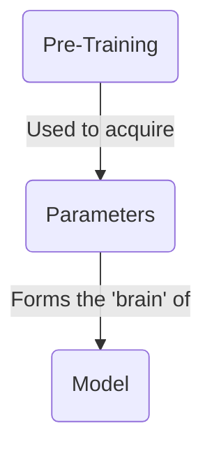
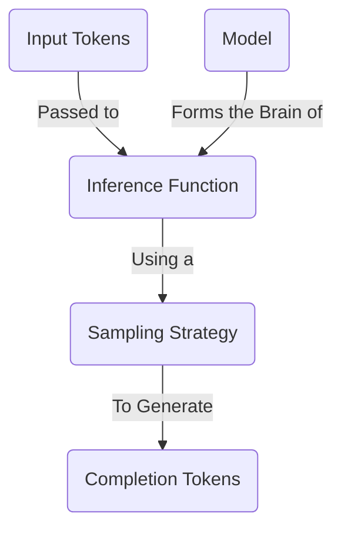
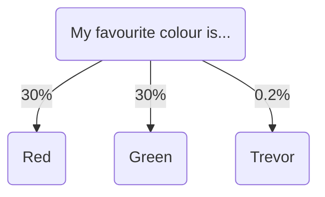
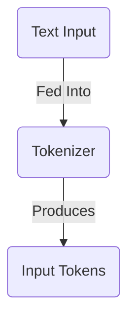
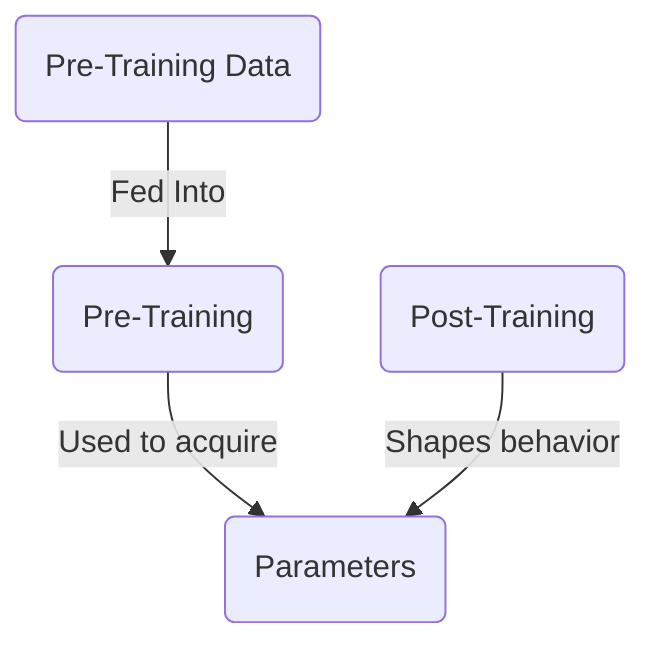
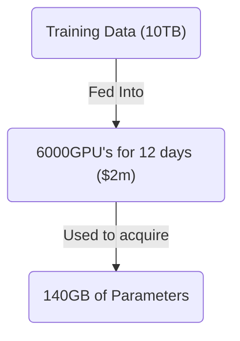
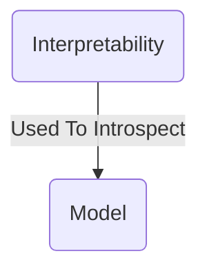

本文会带你了解大语言模型（Large Language Model，LLM）的基础知识：它是什么、如何工作，以及人们大致怎样训练出一个模型。

现有的许多资料会深入讲解 LLM 的工作原理，本文不会钻得那么深。我只会简要介绍最常见的概念，让你接着就能动手构建。

## 什么是大语言模型？



你可以把大语言**模型**（model）大致理解成一个巨型压缩文件，比如一个 1TB 的 zip 文件。文件里存放着大量数字，以 16 位浮点数的形式编码。这些数字就是模型的**参数**（parameters）。

译注：浮点数是计算机保存小数的一种方式；16 位指每个数使用的存储位数。这里的压缩文件比喻用于帮助理解，原文并未提供可供下载或运行的模型文件。

```txt
0.1239784871238176123 // Parameter 1
0.1515689756890123123 // Parameter 2
```

这些参数构成了模型的“大脑”。它们来自模型的**预训练（pre-training）**：这个过程会读取海量文本数据，再把从中学到的规律“压缩”进这些数字。参数承载着模型对世界的理解，使它能够记住事实并作出判断。

参数数量可以粗略看作模型“大脑”的大小。一般来说，参数更多的模型表现更好，但运行也更慢。一个拥有 **700 亿（70B）参数的模型，运行速度约为 70 亿（7B）参数模型的十分之一**。

这里已经出现了选择大语言模型时常见的一项取舍：模型规模与运行速度往往难以兼得。

## 怎样运行大语言模型？



要让模型完成有用的任务，需要让它执行**推理（inference）**。

推理就是把文本发给模型，再得到模型的回答。这个过程由**推理函数**（inference function）完成：它是一段软件，会读取模型参数并运行算法，计算下一个词。与预训练相比，推理便宜得多，也可以在笔记本电脑上运行。

想深入了解推理的工作方式，可以查看这份很出色的 [交互式讲解](https://bbycroft.net/llm)。

### 采样策略

生成下一个词时，模型会查看所有可选的 Token，并从中选出一个。



译注：图里的句子是“我最喜欢的颜色是……”，三个候选分别为 Red（红色）、Green（绿色）和 Trevor（人名）。标注的概率依次为 30%、30% 和 0.2%。

具体怎样选择，由开发者指定的**采样策略**（sampling strategy）决定。常见策略包括：

- **贪心采样（Greedy Sampling）**：始终选择概率最高的词。
- **Top-K 采样（Top-K Sampling）**：从概率最高的 K 个候选词中选择。
- **Top-P 采样（Top-P Sampling）**：从累计概率达到 P% 的一组候选词中选择。
- **温度采样（Temperature Sampling）**：在选择过程中引入随机性，让输出更加多样。

本文不会展开这些策略的具体原理。通常，作为 AI 工程师，你无法改变所用模型的采样策略；不过，你可以调整温度（temperature）等变量，获得不同的结果。

## 什么是输入 Token？



把文本发给模型后，首先要对它进行 **Token 化（tokenized）**。按原文的简化说法，就是把文本拆成一个个词，再将这些词转换成数字。这些数字就是输入 Token，随后会被传给推理引擎。

译注：这里的“词”是入门说明。Token 不一定是完整单词，可能是字、词的一部分或其他文本片段；下文的词汇表也沿用这个区别。

每个模型都有自己的分词器（tokenizer）。你可以在 [Tiktokenizer](https://tiktokenizer.vercel.app/) 这个交互工具中尝试不同的文本，直观看看不同分词器会怎样切分它们。

## 怎样创建一个模型？



要得到模型参数，就需要训练模型。训练大语言模型极其复杂，需要投入大量时间、专业知识和资金。具体怎样训练并不在本文的讨论范围内。

下面用一组粗略数字帮助你理解这个过程：从互联网中取出一批数据，比如 10TB；动用 6,000 块 GPU 训练 12 天，花费约 200 万美元；最终得到一个约 140GB 的文件，其中保存着模型的全部参数。



训练过程主要分为两个阶段：

1. **预训练（Pre-training）**：把从海量互联网数据中学到的知识压缩进参数。
2. **后训练（Post-training）**：通过精心设计的指令和示例，塑造模型的个性与行为。

最后得到的是一个巨大的参数文件。它有点像全部训练数据的“压缩版”，而后训练又进一步塑造了模型的行为。没有后训练，模型就只是一团静止的知识，不知道该怎样像一位乐于助人的助手那样回应用户。

#### 资源

- Andrej Karpathy 的 [大语言模型入门](https://www.youtube.com/watch?v=zjkBMFhNj_g)
- Andrej Karpathy 的 [我是如何使用 LLM 的](https://www.youtube.com/watch?v=EWvNQjAaOHw)

## 怎样了解模型内部？



研究人员可以尝试深入分析模型参数，找出哪些参数与现实世界中的哪些概念有关，不过这非常困难。例如，Anthropic 发现，模型可能会：

- 在不同语言之间共享概念，这表明模型内部或许存在某种通用的“思维语言”。
- 在写作时提前规划，例如写诗时预先安排押韵。
- 通过多条并行路径完成任务，例如进行心算。
- 有时编造听起来合理的推理过程，而没有展示真实的内部思考过程。

更了解模型怎样“思考”，可以帮助我们预判它的行为，也有望减少那种令人难以信任的“神秘感”。未来，这或许能带来更可控、结果更确定的 AI 系统，但相关研究仍处于早期阶段。

#### 资源

- Anthropic 的 [追踪大语言模型的思考过程](https://www.anthropic.com/research/tracing-thoughts-language-model)
- Anthropic 的 [Golden Gate Claude](https://www.anthropic.com/news/golden-gate-claude)

## 总结

大语言模型把海量知识压缩进数字参数。虽然背后的数学原理很复杂，但你不必先弄懂所有内部细节，照样可以有效使用它。只要先掌握这张基础“地图”，就能逐渐建立起对模型工作方式的可靠直觉。

下一篇文章会介绍如何根据自己的具体需求选择合适的 LLM。

## 译注：术语小词典

- **大语言模型（Large Language Model，LLM）**：一种从大量文本中学习规律，并能理解和生成文本的 AI 模型。
- **参数**（parameters）：模型内部的大量数字，可以粗略理解为模型从训练资料中学到的知识和规律所存放的位置。
- **预训练（pre-training）**：让模型从海量数据中学习语言规律和知识的初始训练阶段。
- **后训练（post-training）**：预训练完成后，用指令和示例继续调整模型行为的阶段。
- **推理（inference）**：运行已经训练好的模型，让它根据输入生成回答的过程。
- **Token**：模型读取和生成文本时使用的基本单位，可能对应一个字、一个词或词的一部分。
- **分词器（tokenizer）**：把文本切分成 Token，并将其转换成模型能够处理的数字表示的工具。
- **采样策略**（sampling strategy）：模型从多个候选 Token 中选择下一个 Token 时采用的规则。
- **温度（temperature）**：控制生成结果随机程度的设置；数值越高，输出通常越多样，数值越低，输出通常越稳定。
- **GPU**：擅长同时执行大量计算的处理器，是训练大型 AI 模型常用的硬件。
- **可解释性（interpretability）**：研究如何理解模型内部工作机制，以及模型为何产生某种结果的领域。
